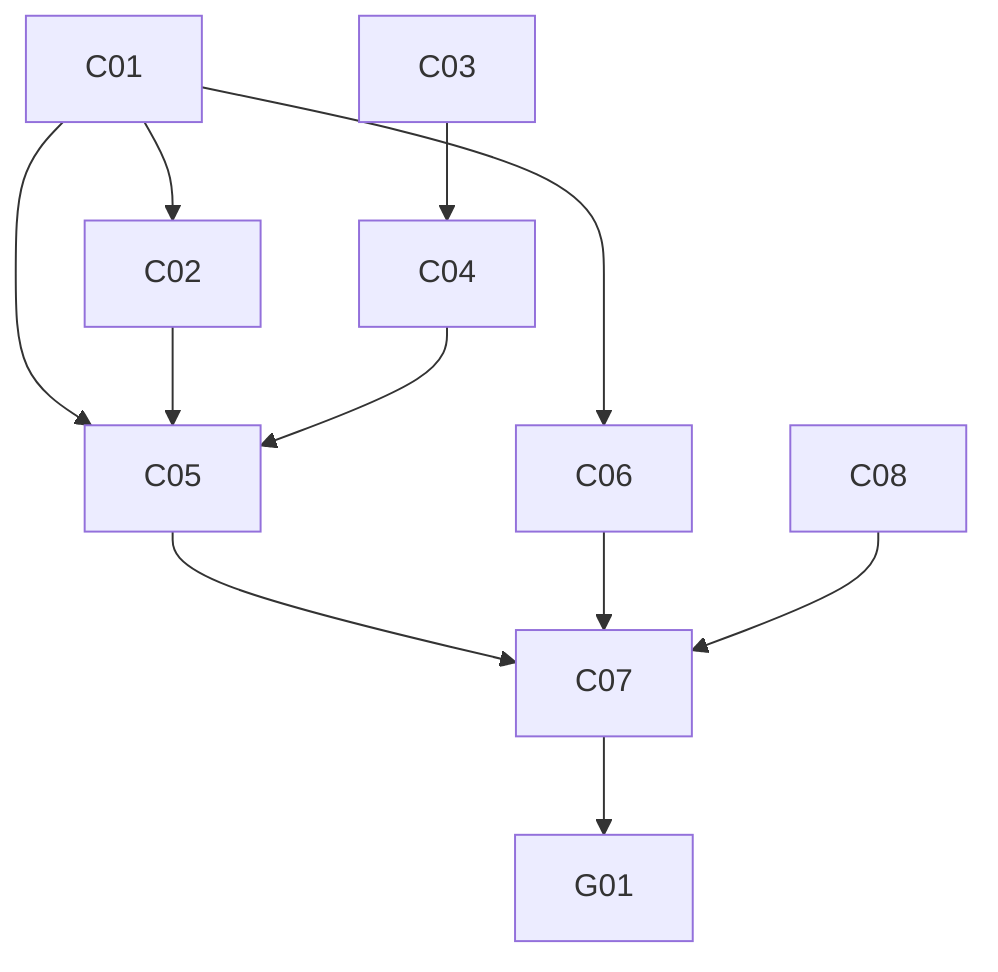

# 道具（capability）MVP 計画

`docs/design/capabilities.md`・`principles.md`・`security.md` を前提にした、道具の MVP の Goal / Epic / Issue / 依存関係。Epic 名は `docs/plan/mvp-plan.md` の E0〜E5、`voice-plan.md` の VE1〜VE4 と区別するため CE1〜CE5 とする。

## MVP Goal

オーナーがギルドのテキストチャンネルで話しかけると、Yukarin が Google カレンダーの予定を確認して答える。予定の登録を頼むと、内容を聞き返し、オーナーの了承を得てから登録する。

道具の呼び出しは body ではなく、core 内の独立した層に置く。道具を使うかは brain（LLM の tool use）が判断し、実行の可否は capability gate が Partner の capability policy で判定し、呼び出しは adapter が行う。契約・policy・adapter は `packages/capabilities` に置き、`apps/worker` は組み立てだけを持つ。

デモ手順:

1. dev サーバーでオーナーが「明日の予定ある？」と聞く → Yukarin が dev 用のテストカレンダーを読み、そのターンのうちに答える。
2. 「明日19時に歯医者入れて」と頼む → Yukarin が「18日 19:00 から歯医者、で入れていい？」と聞き返す。この時点ではカレンダーに何も書かれていない。
3. 「うん」と返す → 予定が登録され、Yukarin が登録したことを伝える。
4. 「やっぱりやめて」と返したときや、10 分以内に返事がないときは、保留が取り消され、何も登録されない。
5. オーナー以外が同じ依頼をすると、Yukarin は道具を使わずに断る。Audit には拒否が記録される。

## Epic 一覧

| Epic | ユーザーから見える成果 | 依存 |
| --- | --- | --- |
| CE1 | 道具の契約、policy の判定、保留中の操作の状態遷移が、Workers に依存しない形で揃う | なし |
| CE2 | brain が LLM の tool use で道具を呼び、結果を受けてから TurnResponse を返せる | CE1 |
| CE3 | カレンダーの確認と登録が、Worker の中で gate と adapter を通って動く | CE1, CE2, CE4 |
| CE4 | Google の OAuth が通り、dev で通しの確認が取れる | なし |
| CE5 | （後続）Gmail の検索・本文の要約・下書き | CE3 |

### CE1. 道具の契約と gate

- 技術範囲: `packages/capabilities` を新設する（`@yunomi/core` に依存）。`CapabilityRequest` / `CapabilityResponse`、道具の定義（名前、説明、入力スキーマ、policy のカテゴリ）、入力の Valibot 検証、policy の判定（Partner の `capability_defaults` と、発言者がオーナーか）、保留中の操作の状態遷移（提案 → 実行 / 取り消し / 期限切れ）、adapter のインターフェース。`partners/yukarin/profile.yaml` の `capability_defaults` にカレンダーのカテゴリを足す。
- 非ゴール: adapter の実装、LLM との接続、保存。
- Done: 判定と状態遷移が純粋関数で、auto / confirm / deny、オーナー以外、期限切れの各経路が unit test で保証される。

### CE2. brain の道具ループ

- 技術範囲: `packages/llm` に provider 非依存の `ToolSpec`、tool_use と tool_result を含むメッセージ、`ClaudeProvider` での `tools` の受け渡しを足す（fake も追従する）。`apps/worker/src/do/turn.ts` に道具の呼び出しループ（回数と待ち時間に上限）を足し、tool_use ごとに gate を通す。`packages/conversation` のプロンプトに、現在日時（JST）のブロック、保留中の操作のブロック、道具の使い方の規則を足す。`tool_intents` は TurnResponse から外し、実際の道具の呼び出しを Audit に記録する形に置き換える。
- 非ゴール: 状況に応じて道具の定義を出し入れすること（prompt cache が外れるため、Partner ごとに固定する）、server tool（web_search）。
- Done: fake の LLM と fake の adapter を使ったテストで、読み取り（同じターンで答える）、登録の提案（保留して聞き返す）、了承、取り消し、拒否の経路が再現する。

### CE3. カレンダーの adapter と組み立て

- 技術範囲: `packages/capabilities` に Google Calendar の adapter（予定の一覧と作成、refresh token からの access token の取得、`fetch` のみ）。予定の ID は Discord のメッセージ ID から決め、同じ依頼の二重登録を防ぐ。`apps/worker` に組み立て（オーナーの Discord user id、カレンダー ID、Google の secret）、保留中の操作の DO SQLite テーブル、Audit の kind への道具の実行の追加、secret の一覧と README の更新。eval の `08-cannot-do` の期待値を見直す。
- 非ゴール: 予定の変更・削除、カレンダーの内部ミラー、Discord のボタンでの確認。
- Done: fake の adapter で組み立てたテストで、CE2 の経路が Worker 上で再現する。CE4 が揃ったら、dev のテストカレンダーで確認と登録の通しが取れる。

### CE4. Google の OAuth と通しの確認

- 技術範囲: Google Cloud のプロジェクトと OAuth クライアント、同意画面の公開ステータス（本番）、scope `calendar.events`、refresh token を取得する手順、1Password への保存、dev と prod の Worker secret の登録、dev 用のテストカレンダー。
- 非ゴール: prod での通しの確認、Gmail の scope。
- Done: dev の Worker から Google Calendar API を呼べる。refresh token が 7 日で失効しない状態になっている。

### CE5. Gmail（後続）

- 技術範囲: 段階を分けて開ける。件名・差出人・snippet での検索、本文の要約、下書きの作成（confirm）の順。本文は保存せず、Audit には検索したことと件数だけを残す。
- 前提: 本文の要約はオーナーの DM の中だけで行う。今の Gateway はギルドのメッセージしか中継しないため、DM の受信を先に足す。Gmail の scope は Google の分類で restricted なので、未審査で使えるかを確かめる。
- この計画では Issue を G01 の 1 つだけ立て、カレンダーの MVP が終わってから分割する。

## Issue 一覧

番号は計画上の ID。右端の列が GitHub Issue の番号。

| ID | Epic | タイトル | 依存 | 並行 | GitHub |
| --- | --- | --- | --- | --- | --- |
| C01 | CE1 | packages/capabilities の契約、道具の定義、policy の判定 | - | C03, C08 と並行 | #131 |
| C02 | CE1 | 保留中の操作の状態遷移 | C01 | C04, C06 と並行 | #132 |
| C03 | CE2 | tools と構造化出力の併用を確かめる | - | C01, C08 と並行 | #133 |
| C04 | CE2 | packages/llm に ToolSpec と tool use を足す | C03 | C02, C06 と並行 | #134 |
| C05 | CE2 | turn.ts の道具ループとプロンプト | C01, C02, C04 | C06 と並行 | #135 |
| C06 | CE3 | Google Calendar の adapter | C01 | C02, C04, C05 と並行 | #136 |
| C07 | CE3 | Worker の組み立てと保存、Audit | C05, C06 | - | #138 |
| C08 | CE4 | Google の OAuth と secret の登録、dev での通しの確認 | なし（通しの確認は C07） | C01〜C06 と並行 | #137 |
| G01 | CE5 | Gmail を読めるようにする（後続） | C07 | - | #139 |

C08 の Google Cloud と OAuth の設定はオーナーが行う。yunomi の Issue はその進捗を追い、secret の登録と dev での通しの確認を Done とする。

## 依存グラフ

### クリティカルパス

C01 → C02 → C05 → C07 と、C03 → C04 → C05 → C07 の 2 本。C05 で合流する。

### 並行して進められる作業

- C01 / C03 / C08 は最初から並行
- C01 の後: C02 / C06
- C03 の後: C04
- C08 はオーナーの作業が終わるまで、C07 は fake の adapter で進める

### 非ゴール

- 予定の変更・削除
- Discord のボタンでの確認（`security.md` にある形。この MVP では返答の言葉で確認する）
- web_search などの server tool、Home Node の MCP
- 予定をきっかけに自分から話しかけること（`decisions.md` の proactive behavior）
- DM の受信

### 確かめておくこと

- tools と `output_config.format`（json_schema）を同じリクエストで使い、道具のループのあとで TurnResponse を返せるか。Sonnet（server-side fallback の beta 付き）と Haiku の両方で確かめる（C03）。
- Google Calendar の予定 ID をクライアント側で指定できる条件（使える文字と長さ）。メッセージ ID から作る方式が成り立つか（C06）。
- 同意画面を本番にしたとき、未審査のまま自分のアカウントで `calendar.events` を使えるか（C08）。

### 判断が必要な点

要判断: 確認の方法。この計画では返答の言葉で確認し、ボタンは後続とする。

要判断: 保留の期限。この計画では 10 分とし、同じチャンネルで新しい提案が来たら古い保留は取り消す。

要判断: dev の書き込み先。`security.md` の dev safety に従い、dev は専用のテストカレンダーにだけ書き込む。カレンダー ID は環境ごとの binding で持つ。

要判断: `tool_intents` の扱い。この計画では TurnResponse から外し、Audit に実際の道具の呼び出しを残す。Admin の表示も合わせて変える。

### 最初の 3 Issue

1. C01 packages/capabilities の契約、道具の定義、policy の判定
2. C03 tools と構造化出力の併用を確かめる
3. C08 Google の OAuth と secret の登録、dev での通しの確認

C01 で契約を固め、C03 で LLM 側の前提を確かめると、C02・C04・C06 が並行に進められる。C08 はオーナーの作業なので最初から走らせる。
