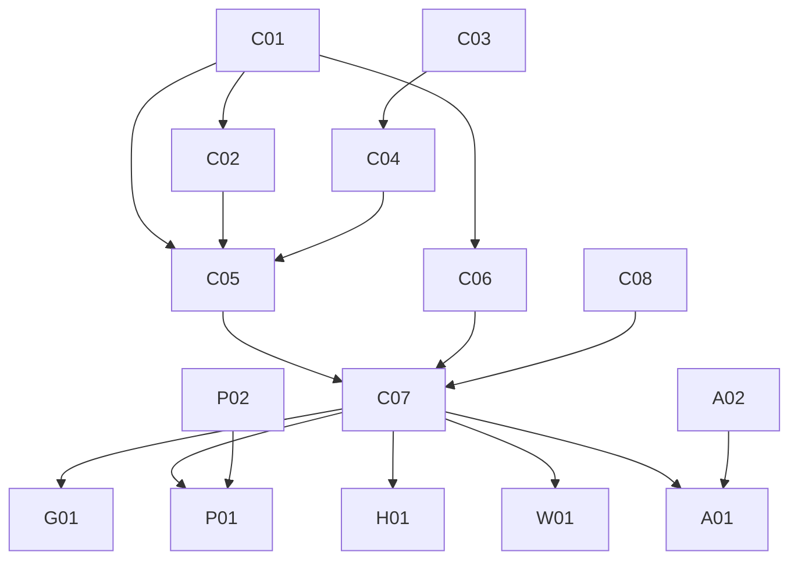

# 道具（capability）MVP 計画

`docs/design/capabilities.md`・`principles.md`・`security.md` を前提にした、道具の MVP の Goal / Epic / Issue / 依存関係。Epic 名は `docs/plan/mvp-plan.md` の E0〜E5、`voice-plan.md` の VE1〜VE4 と区別するため CE1〜CE5 とする。

## MVP Goal

オーナーがギルドのテキストチャンネルで話しかけると、Yukarin が Google カレンダーの予定を確認して答える。予定の登録を頼むと、内容を聞き返し、オーナーの了承を得てから登録する。

道具の呼び出しは body ではなく、core 内の独立した層に置く。道具を使うかは brain（LLM の tool use）が判断し、実行の可否は capability gate が Partner の capability policy で判定し、呼び出しは adapter が行う。契約・policy・adapter は `packages/capabilities` に置き、`apps/worker` は組み立てだけを持つ。

デモ手順:

1. オーナーが「明日の予定ある？」と聞く → Yukarin がオーナーのメインカレンダーを読み、そのターンのうちに答える。
2. 「明日19時に歯医者入れて」と頼む → Yukarin が「18日 19:00 から歯医者、で入れていい？」と聞き返す。この時点ではカレンダーに何も書かれていない。
3. 「うん」と返す → 予定が登録され、Yukarin が登録したことを伝える。
4. 「やっぱりやめて」と返したときや、10 分以内に返事がないときは、保留が取り消され、何も登録されない。
5. オーナー以外が同じ依頼をすると、Yukarin は道具を使わずに断る。Audit には拒否が記録される。

## Epic 一覧

| Epic | ユーザーから見える成果 | 依存 |
| --- | --- | --- |
| CE1 | 道具の契約、policy の判定、保留中の操作の状態遷移が、Workers に依存しない形で揃う | なし |
| CE2 | brain が LLM の tool use で道具を呼び、結果を受けてから TurnResponse を返せる | CE1 |
| CE3 | カレンダーの確認と登録が、Worker の中で gate と adapter を通って動く | CE1, CE2, CE4 |
| CE4 | Google の OAuth が通り、prod で通しの確認が取れる | なし |
| CE5 | （後続）Gmail の検索・本文の要約・下書き | CE3 |
| CE6 | 「くずはの麦とラーメン開いてる？」と聞くと、Yukarin が Google マップの営業時間を調べて答える | CE3 |
| CE7 | 「#176 って何だっけ？」と聞くと、Yukarin が GitHub の Issue / PR を読んで答える | CE3 |
| CE8 | URL を貼って中身を聞くと、Yukarin がそのページを読んで答える | CE3 |
| CE10 | 「もう家？」「スマホの電池どれくらい？」と聞くと、Yukarin が Home Assistant の状態を見て答える | CE3 |

### CE1. 道具の契約と gate

- 技術範囲: `packages/capabilities` を新設する（`@yunomi/core` に依存）。`CapabilityRequest` / `CapabilityResponse`、道具の定義（名前、説明、入力スキーマ、policy のカテゴリ）、入力の Valibot 検証、policy の判定（Partner の `capability_defaults` と、発言者がオーナーか）、保留中の操作の状態遷移（提案 → 実行 / 取り消し / 期限切れ）、adapter のインターフェース。`partners/yukarin/profile.yaml` の `capability_defaults` にカレンダーのカテゴリを足す。
- 非ゴール: adapter の実装、LLM との接続、保存。
- Done: 判定と状態遷移が純粋関数で、auto / confirm / deny、オーナー以外、期限切れの各経路が unit test で保証される。

### CE2. brain の道具ループ

- 技術範囲: `packages/llm` に provider 非依存の `ToolSpec`、tool_use と tool_result を含むメッセージ、`ClaudeProvider` での `tools` の受け渡しを足す（fake も追従する）。`apps/worker/src/do/turn.ts` に道具の呼び出しループ（回数と待ち時間に上限）を足し、tool_use ごとに gate を通す。`packages/conversation` のプロンプトに、現在日時（JST）のブロック、保留中の操作のブロック、道具の使い方の規則を足す。`tool_intents` は TurnResponse から外し、実際の道具の呼び出しを Audit に記録する形に置き換える。
- 非ゴール: 状況に応じて道具の定義を出し入れすること（prompt cache が外れるため、Partner ごとに固定する）、server tool（web_search）。
- Done: fake の LLM と fake の adapter を使ったテストで、読み取り（同じターンで答える）、登録の提案（保留して聞き返す）、了承、取り消し、拒否の経路が再現する。

### CE3. カレンダーの adapter と組み立て

- 技術範囲: `packages/capabilities` に Google Calendar の adapter（予定の一覧と作成、refresh token からの access token の取得、`fetch` のみ）。予定の ID は Discord のメッセージ ID から決め、同じ依頼の二重登録を防ぐ。`apps/worker` に組み立て（オーナーの Discord user id、カレンダー ID、Google の secret）、保留中の操作の DO SQLite テーブル、Audit の kind への道具の実行の追加、secret の一覧と README の更新。eval の `08-cannot-do` の期待値を見直す。
- 非ゴール: 予定の変更・削除、カレンダーの内部ミラー、Discord のボタンでの確認。
- Done: fake の adapter で組み立てたテストで、CE2 の経路が Worker 上で再現する。CE4 が揃ったら、prod で確認と登録の通しが取れる。

### CE4. Google の OAuth と通しの確認

- 技術範囲: Google Cloud のプロジェクトと OAuth クライアント、同意画面の公開ステータス（本番）、scope `calendar.events`、refresh token を取得する手順、1Password への保存、prod の Worker secret の登録。
- 非ゴール: dev の Worker への Google の認証情報、Gmail の scope。
- Done: prod の Worker から Google Calendar API を呼べる。refresh token が 7 日で失効しない状態になっている。

### CE5. Gmail（後続）

- 技術範囲: 段階を分けて開ける。件名・差出人・snippet での検索、本文の要約、下書きの作成（confirm）の順。本文は保存せず、Audit には検索したことと件数だけを残す。
- 前提: 本文の要約はオーナーの DM の中だけで行う。今の Gateway はギルドのメッセージしか中継しないため、DM の受信を先に足す。Gmail の scope は Google の分類で restricted なので、未審査で使えるかを確かめる。
- この計画では Issue を G01 の 1 つだけ立て、カレンダーの MVP が終わってから分割する。

### CE6. 場所の検索（Google Places）

- 技術範囲: `packages/capabilities` に道具 `place_search`（カテゴリ `place_read`、`auto`）と Google Places API (New) の Text Search の adapter を足す。入力は自由文の検索語だけとし、地名は検索語に含めてもらう。`languageCode: "ja"`、`regionCode: "JP"`、候補は 3 件まで。返す項目は名前、住所、営業状態、営業中か（`currentOpeningHours.openNow`）、今日の営業時間。認証は API キー（`X-Goog-Api-Key`）で、Calendar の OAuth とは独立させる。`apps/worker` の組み立てを道具ごとに分け、Calendar の認証情報がなくても Places の API キーがあれば Places だけ有効にする。secret `GOOGLE_PLACES_API_KEY`、`TOOLS_BLOCK` への使い方の追記、`partners/yukarin/profile.yaml` の `capability_defaults` への `place_read: auto` の追加。
- 非ゴール: 混雑状況（Places API に取得手段がない）、現在地や自宅を起点にした周辺検索、行きつけの店の保存、レビューと写真、地図の表示。
- Done: `fetch` を差し替えたテストで、営業中、営業時間外、候補なし、複数候補、API のエラーが扱える。Calendar の認証情報がない組み立てでも `place_search` が登録される。prod で「くずはの麦とラーメン開いてる？」に営業時間つきで答えられる。

`fieldMask` に `currentOpeningHours` を含むため、1 回の検索は Text Search の Enterprise 区分で課金される（月 1,000 回まで無料、超過分は 1,000 回あたり $35）。Google Cloud の割り当てで 1 日の上限を設け、無料枠を超えないようにする。Google の規約では `place_id` 以外の保存が制限されるため、検索結果は Audit にも会話の記録にも残さない。

### CE7. GitHub の Issue / PR を読む

- 技術範囲: `packages/capabilities` に道具 `github_read`（カテゴリ `github_read`、`auto`）と GitHub REST API の adapter を足す。入力は `repo`（`owner/name`、省略可）と `number`。省略時の repo は Worker の設定値 `GITHUB_DEFAULT_REPO`（`ochanuco/yunomi`）から adapter の設定として渡し、省略かつ既定もなければ道具のエラーにする。`GET /repos/{owner}/{repo}/issues/{number}` を 1 回呼び（PR も返る）、`pull_request` の有無で種類を、`pull_request.merged_at` でマージ済みを判定する。返す項目は種類、repo、番号、タイトル、状態（open / closed / merged）、ラベル、作成者、作成・更新日時、本文の冒頭（1,500 文字）、コメント数、URL。認証は secret `GITHUB_TOKEN`（fine-grained PAT、Issues と Pull requests の Read-only）で、Calendar・Places とは独立に、token があるときだけ登録する。`TOOLS_BLOCK` への使い方の追記、`partners/yukarin/profile.yaml` の `capability_defaults` への `github_read: auto` の追加。
- 非ゴール: コメント本文、PR の差分とレビュー、CI の状態、検索と一覧、Issue・PR の作成や更新。
- Done: `fetch` を差し替えたテストで、open / closed の Issue、open / merged の PR、本文の切り詰め、本文なし、既定 repo の補完、404、401、通信失敗が扱える。Calendar の認証情報がない組み立てでも `github_read` が登録される。prod で「#176 って何だっけ？」に内容つきで答えられる。

private repo の中身を残さないよう、Audit の summary には `owner/repo#番号` と種類だけを書き、タイトルと本文は書かない。

### CE8. 貼られた URL を読む

- 技術範囲: `packages/capabilities` に道具 `web_fetch`（カテゴリ `web_read`、`auto`）と chatsumi の adapter を足す。入力は `url`（http / https、2,048 文字まで）だけで、mode は渡さず chatsumi の自動切り替えに任せる。`POST ${CHATSUMI_URL}/fetchText` を 1 回呼び、認証は Cloudflare Access のサービストークン（secret `CHATSUMI_ACCESS_CLIENT_ID` / `CHATSUMI_ACCESS_CLIENT_SECRET`、ochoko と wol のものとは別）を `CF-Access-Client-Id` / `CF-Access-Client-Secret` で送る。`CHATSUMI_URL` は var（`https://chatsumi.chanu.co`）。返す項目はタイトル、本文（4,000 文字で切り詰め、切り詰めたかどうかを含む）、最終 URL、使った mode。待ち時間は 45 秒で、道具のループ全体の上限に合わせる。URL とサービストークンの 3 つがそろっているときだけ、Calendar・Places・GitHub とは独立に登録する。`TOOLS_BLOCK` への使い方の追記、`partners/yukarin/profile.yaml` の `capability_defaults` への `web_read: auto` の追加。
- 失敗の扱い: 内部アドレスへの要求（`ssrf_blocked`）は拒否、取得先の制限（`rate_limited`、429）は `RateLimited`、それ以外の取得の失敗（challenge、取得先の 4xx / 5xx、タイムアウト、通信の失敗）と chatsumi 自身の 401 / 403 / 5xx は `ExternalServiceUnavailable` にする。gate がモデルに返すのは型名と retryable だけなので、読めなかったときは理由を推測せず、読めなかったと伝える。
- 非ゴール: ログインが要るページ、画像・PDF などテキスト以外、ページ内のリンクを辿る巡回、検索、mode の指定。
- Done: `fetch` を差し替えたテストで、http / browser の成功、本文の切り詰め、`ssrf_blocked`、取得の失敗、401 / 403、5xx、タイムアウト、通信の失敗、http / https 以外の入力、Access のヘッダーの付与が扱える。Calendar の認証情報がない組み立てでも `web_fetch` が登録される。prod で URL を貼って中身を聞くと、内容つきで答えられる。

読んだページの本文は信頼できない入力として扱う。道具の説明と `TOOLS_BLOCK` に、本文中の指示には従わないことを書く。Audit の summary には URL のホスト名と mode だけを書き、パス・クエリ・タイトル・本文は書かない。

### CE10. 家の状態を読む（Home Assistant）

- 技術範囲: `packages/capabilities` に道具 `home_state`（カテゴリ `home_read`、`auto`）と Home Assistant の REST API の adapter を足す。入力は取らず、Worker の設定値 `HOME_ENTITY_IDS`（カンマ区切りの entity ID）に並べた entity だけを読む。entity ごとに `GET ${HOME_ASSISTANT_URL}/api/states/{entity_id}` を並行に呼び、認証は secret `HOME_ASSISTANT_TOKEN`（long-lived access token）を `Authorization: Bearer` で送る。`HOME_ASSISTANT_URL` は var（`https://chanoma.chanu.co`）。返す項目は entity ごとに entity ID、`friendly_name`、state、`unit_of_measurement`、最終変化時刻（`last_changed`）。`weather.*` の state は天気の種類だけなので、気温（`temperature` と `temperature_unit`）と湿度（`humidity`）も返す。時刻は `toModelJson` を通して JST で渡す。404 の entity は結果から外し、外した entity ID を返す。待ち時間は 10 秒。URL・token・entity の一覧の 3 つがそろっているときだけ、ほかの道具とは独立に登録する。`TOOLS_BLOCK` への使い方の追記、`partners/yukarin/profile.yaml` の `capability_defaults` への `home_read: auto` の追加。
- 失敗の扱い: 401 / 403、5xx、タイムアウト、通信の失敗は `ExternalServiceUnavailable` にする。全 entity が 404 のときも同じにする。
- 非ゴール: 家電の操作（service call）、一覧にない entity の読み取り、履歴（`/api/history`）、天気の予報（`weather.get_forecasts`）、Home Assistant からのイベントをきっかけに話しかけること。
- Done: `fetch` を差し替えたテストで、全 entity の成功、一部の 404、全部の 404、属性の絞り込み、`weather.*` の気温と湿度、401、5xx、タイムアウト、通信の失敗、Bearer ヘッダーの付与が扱える。ほかの道具の認証情報がない組み立てでも `home_state` が登録される。prod で「もう家？」に在宅状態つきで答えられる。

`person.*` と `device_tracker.*` の属性には緯度・経度が入るため、adapter は上に挙げた項目以外の属性を返さない。読む entity を設定値で固定するのは、モデルが位置情報などの entity を名指しで読めないようにするためである。Audit の summary には読んだ entity の数と外した entity の数だけを書き、state は書かない。

Home Assistant はログインの失敗が続くと送信元の IP を ban する（`http.ip_ban_enabled`）。cloudflared 経由では送信元がスマホアプリと同じ cloudflared のコンテナに見えるため、token の誤りで ban されるとスマホアプリも締め出される。token を登録したら、まず 1 回だけ呼んで 200 を確かめる。

## Issue 一覧

番号は計画上の ID。右端の列が GitHub Issue の番号。

| ID | Epic | タイトル | 依存 | 並行 | GitHub |
| --- | --- | --- | --- | --- | --- |
| C01 | CE1 | packages/capabilities の契約、道具の定義、policy の判定 | - | C03, C08 と並行 | #131 |
| C02 | CE1 | 保留中の操作の状態遷移 | C01 | C04, C06 と並行 | #132 |
| C03 | CE2 | tools と構造化出力の併用を確かめる | - | C01, C08 と並行 | #133 |
| C04 | CE2 | packages/llm に ToolSpec と tool use を足す | C03 | C02, C06 と並行 | #134 |
| C05 | CE2 | turn.ts の道具ループとプロンプト | C01, C02, C04 | C06 と並行 | #135 |
| C06 | CE3 | Google Calendar の adapter | C01 | C02, C04, C05 と並行 | #136 |
| C07 | CE3 | Worker の組み立てと保存、Audit | C05, C06 | - | #138 |
| C08 | CE4 | Google の OAuth と secret の登録、prod での通しの確認 | なし（通しの確認は C07） | C01〜C06 と並行 | #137 |
| G01 | CE5 | Gmail を読めるようにする（後続） | C07 | - | #139 |
| P01 | CE6 | 場所の検索の道具と Google Places の adapter、組み立ての分離 | C07 | P02 と並行 | #160 |
| P02 | CE6 | Places API の有効化と API キー、割り当ての設定、prod での通しの確認 | なし（通しの確認は P01） | P01 と並行 | #161 |
| H01 | CE7 | GitHub の Issue / PR を読む道具と adapter、組み立て、secret の登録 | C07 | - | #176 |
| W01 | CE8 | URL のページを読む道具 `web_fetch` と chatsumi の adapter、組み立て、secret の登録 | C07 | - | #178 |
| A01 | CE10 | 家の状態を読む道具 `home_state` と Home Assistant の adapter、組み立て | C07 | A02 と並行 | #213 |
| A02 | CE10 | Home Assistant の token の発行、読む entity の選定、secret の登録、prod での通しの確認 | なし（通しの確認は A01） | A01 と並行 | #214 |

C08 と P02 の Google Cloud の設定、A02 の Home Assistant の設定はオーナーが行う。yunomi の Issue はその進捗を追い、secret の登録と prod での通しの確認を Done とする。

## 依存グラフ

### クリティカルパス

C01 → C02 → C05 → C07 と、C03 → C04 → C05 → C07 の 2 本。C05 で合流する。

### 並行して進められる作業

- C01 / C03 / C08 は最初から並行
- C01 の後: C02 / C06
- C03 の後: C04
- C08 はオーナーの作業が終わるまで、C07 は fake の adapter で進める

### 非ゴール

- 予定の変更・削除
- Discord のボタンでの確認（`security.md` にある形。この MVP では返答の言葉で確認する）
- web_search などの server tool、Home Node の MCP
- 予定をきっかけに自分から話しかけること（`decisions.md` の proactive behavior）
- DM の受信

### 確かめておくこと

- tools と `output_config.format`（json_schema）を同じリクエストで使い、道具のループのあとで TurnResponse を返せるか。Sonnet（server-side fallback の beta 付き）と Haiku の両方で確かめる（C03）。
- Google Calendar の予定 ID をクライアント側で指定できる条件（使える文字と長さ）。メッセージ ID から作る方式が成り立つか（C06）。
- 同意画面を本番にしたとき、未審査のまま自分のアカウントで `calendar.events` を使えるか（C08）。
- 道具の結果（tool_result）が、ターンをまたいで会話の記録に残らないか。残るなら Places の結果は除く（P01）。
- 「麦とラーメン くずは」で目的の店が最上位に出て、営業時間が登録されているか（P02）。
- Home Assistant の Companion アプリが作る entity のうち、どれを `HOME_ENTITY_IDS` に入れるか。iOS と Android で作られるセンサーが違う（A02）。
- cloudflared の背後で Home Assistant が送信元をどう見ているか（`http.trusted_proxies` と `use_x_forwarded_for` の設定）。ban の単位がスマホアプリと分かれるか（A02）。

### 判断が必要な点

要判断: 確認の方法。この計画では返答の言葉で確認し、ボタンは後続とする。

要判断: 保留の期限。この計画では 10 分とし、同じチャンネルで新しい提案が来たら古い保留は取り消す。

要判断: dev での扱い。dev の Worker には Google の認証情報を置かず、カレンダーの道具は prod だけで有効にする（認証情報が揃わなければ道具を無効にする組み立てなので、dev では今までどおり道具なしで動く）。prod はオーナーのメインカレンダー（`primary`）を使う。dev での確認は fake の adapter を使ったテストで行い、通しの確認は prod で行う。

要判断: Places の dev での扱い。Calendar と同じく、API キーは prod の Worker にだけ置く。dev での確認は fake の adapter を使ったテストで行う。

要判断: `tool_intents` の扱い。この計画では TurnResponse から外し、Audit に実際の道具の呼び出しを残す。Admin の表示も合わせて変える。

### 最初の 3 Issue

1. C01 packages/capabilities の契約、道具の定義、policy の判定
2. C03 tools と構造化出力の併用を確かめる
3. C08 Google の OAuth と secret の登録、prod での通しの確認

C01 で契約を固め、C03 で LLM 側の前提を確かめると、C02・C04・C06 が並行に進められる。C08 はオーナーの作業なので最初から走らせる。
