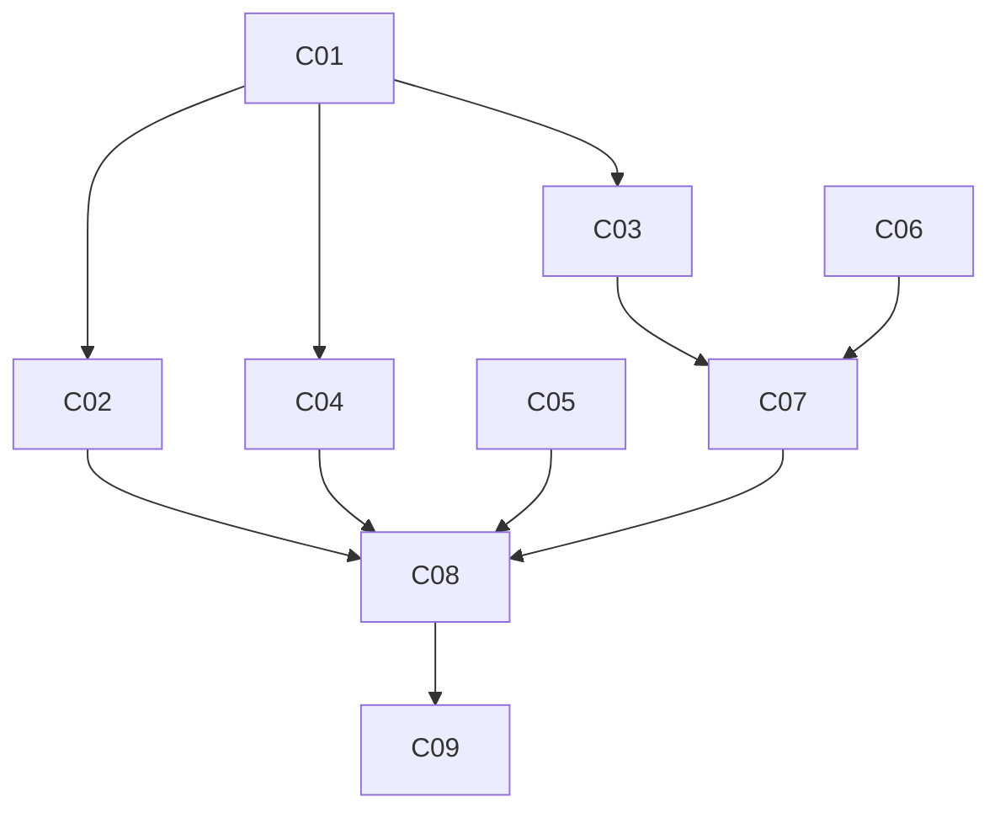

# 会話の器官 MVP 計画

`docs/design/decisions.md` の Conversation organ と `docs/adr/0001-push-voice-directives-over-partner-websocket.md` を前提にした、会話の器官 yunomi-voice の MVP の Goal / Epic / Issue / 依存関係。Epic 名は他の計画と区別するため CV1〜CV4 とする。

## MVP Goal

VC の声の会話を relay から yunomi-voice に移す。yunomi-voice は yunomi-box で ochoko と kukicha の隣に動き、VC への出入り、再生、持ち主の声の聞き取りを受け持つ。relay はテキストの中継だけになる。

振る舞いは今の VC と同じにする。割り込みや相槌のような新しい反射は、この MVP の後に yunomi-voice に足す。

```text
Discord VC ⇄ yunomi-voice（yunomi-box）⇄ ochoko・kukicha（localhost）
yunomi-voice → Worker: VC の状態、持ち主の発話（HTTP、今の口）
Worker（PartnerDO）→ yunomi-voice: 声の指示（WebSocket）
Discord テキスト ⇄ relay（docker01）⇄ Worker
```

デモ手順（prod。dev の bot は Discord につながない）:

1. 持ち主が VC に入ると、yunomi-voice が core の指示でゆかりさんを VC に入れる。
2. 持ち主が話しかけると、yunomi-voice が聞き取って Worker に送り、返事の声が VC で流れる。
3. VC のテキストチャットに文字で書くと、返事のテキストが届き、続けて同じ返事の声が VC で流れる。声の指示は PartnerDO から WebSocket で yunomi-voice に届く。
4. relay を再起動しても、VC の会話は切れない。
5. relay の設定に ochoko と kukicha の URL と token が無い。

## Epic 一覧

| Epic | ユーザーから見える成果 | 依存 |
| --- | --- | --- |
| CV1 | yunomi-voice が yunomi-box で動き、Discord と Worker につながる | なし |
| CV2 | VC への出入り、再生、聞き取りが yunomi-voice で動く | CV1 |
| CV3 | Worker が yunomi-voice を呼び出し元として受け、声の指示を WebSocket で押し出す | なし |
| CV4 | prod で relay から yunomi-voice に切り替わり、relay から VC のコードが消える | CV2, CV3 |

### CV1. yunomi-voice の土台と配備

- 技術範囲: `apps/voice`（`@yunomi/voice`）。設定の検証、キャラの bot の token で Discord の Gateway にもう 1 本つなぐ client（intent は `Guilds` と `GuildVoiceStates` だけ）、Worker の client（Access の service token は voice 用）。yunomi-box 向けの配備物として、GitHub Release の zip、`deploy\register.ps1`（タスクスケジューラのタスクと `C:\ProgramData\yunomi-voice` の設定）、`prepare.ps1`・`stop.ps1`・`check.ps1`。
- インフラ側: chabatake の `gpu-box/apps/yunomi-voice.json`、Access の service token、yunomi-box から Worker への外向きの通信の許可。yunomi-box への Node 24 の導入。
- 非ゴール: VC の機能、akarin の bot での接続。
- Done: gpu-box-app で yunomi-voice が yunomi-box に配られ、起動すると Gateway につながり、Worker の health を Access 越しに呼べる。relay のテキストの中継は今までどおり動く。

### CV2. VC の機能を移す

- 技術範囲: relay の `voice-state.ts`、`voice-manager.ts`、`ochoko-client.ts`、`ears.ts`、`hearing.ts`、`kukicha-client.ts` と、それぞれのテストを `apps/voice` に移す。VC の状態を `voice-events` に送り、応答の `voice_join` / `voice_leave` に従う。持ち主の発話を `discord.voice.utterance` として送り、応答の声の指示で再生する。実際の接続を `voice-connection` に知らせる。ochoko と kukicha は localhost で呼ぶ。
- 非ゴール: WebSocket で届く声の指示（CV3 の後に CV4 でつなぐ）、新しい反射、二人目の口。
- Done: fake の Discord と fake の器官を使ったテストで、relay で通っていた VC の経路（出入り、再生、聞き取り、keep_awake）が yunomi-voice で通る。

### CV3. Worker の受け口

- 技術範囲: `apps/worker` で呼び出し元 `voice` を Access の許可に足し、VC の口（`voice-events`、`voice-connection`、発話）を `voice` から受ける。切り替えのあいだは `gateway` からも受ける。PartnerDO に WebSocket の受け口を足す。Hibernation API（`acceptWebSocket`）で受け、生存確認は `setWebSocketAutoResponse` で返す。VC のテキストチャットの発言のターンで声の指示ができたとき、yunomi-voice がつながっていればその WebSocket に送り、relay への応答には載せない。
- 非ゴール: 発話や VC の状態を WebSocket に載せ替えること。
- Done: テストで、WebSocket がつながっているときは声の指示がそこに届き、relay への応答に載らないこと、つながっていないときは今までどおり応答に載ることが確かめられる。生存確認で PartnerDO が起きない。

### CV4. 切り替えと relay の片付け

- 技術範囲: yunomi-voice を prod に出し、同時に relay の prod の設定から `OCHOKO_URL`・`AIVOICE_TOKEN`・`KUKICHA_URL`・`KUKICHA_TOKEN` を外す（chabatake）。デモ手順を prod で確かめる。確かめた後、`apps/relay` から VC のコードと依存（`@discordjs/voice`、`opusscript`、`@snazzah/davey`）を消し、Worker の VC の口から `gateway` を外す。
- 非ゴール: relay のテキストの経路の変更。
- Done: デモ手順が prod で通る。relay に VC のコードが残っていない。

## Issue 一覧

| ID | Epic | タイトル | 依存 | 並行 |
| --- | --- | --- | --- | --- |
| C01 | CV1 | `apps/voice` の土台（設定、Discord の client、Worker の client） | - | C05, C06 と並行 |
| C02 | CV1 | yunomi-box への配備（Release の zip、register.ps1、gpu-box の manifest） | C01 | C03, C04 と並行 |
| C03 | CV2 | VC への出入りと再生を移す | C01 | C04 と並行 |
| C04 | CV2 | 聞き取りを移す | C01 | C03 と並行 |
| C05 | CV3 | Worker: 呼び出し元 `voice` を受ける | - | C01, C06 と並行 |
| C06 | CV3 | Worker: PartnerDO の WebSocket と声の指示の押し出し | - | C01, C05 と並行 |
| C07 | CV4 | yunomi-voice で声の指示を WebSocket から受ける | C03, C06 | C02 と並行 |
| C08 | CV4 | prod の切り替えと確認 | C02, C04, C05, C07 | - |
| C09 | CV4 | relay から VC のコードを消す | C08 | - |

C02 と C08 のインフラ側（chabatake の manifest、service token、relay の設定）は、インフラ側の担当者が進める。yunomi-box への Node の導入と、初回の `register.ps1` の実行は持ち主が行う。

## 依存グラフ



### クリティカルパス

C01 → C03 → C07 → C08 → C09

C05 と C06 は最初から並行に進められる。C02 は Windows での実行の確かめを含むので、C01 の直後に着手する。

### 並行して進められる作業

- C01 / C05 / C06 は最初から並行
- C01 の後: C02 / C03 / C04
- C03 と C06 の後: C07

### 非ゴール

- 割り込み、相槌のキャッシュ、話し終わりの検出の改良、聞き取りと合成の逐次処理
- akarin の口と、二人の話す順番
- 思考を yunomi-voice に置くこと。逐次処理を作る段階で、会話の短い記憶を共有する口とあわせて決め直す
- Discord 以外の音声の経路

### 確かめておくこと

- 同じ bot の token で Gateway に 2 本つないだとき、relay のテキストの受信と yunomi-voice の VC が互いを邪魔しないか。同じイベントが両方に届くことを前提に、yunomi-voice は VC の状態以外を捨てる。
- yunomi-box の Windows と Node 24 で、`@discordjs/voice` の DAVE（`@snazzah/davey`）と `opusscript` が動くか。C02 で最初に確かめる。
- yunomi-box は Wi-Fi で CPU も非力なので、VC の音声が途切れないか。
- Node の WebSocket client が Access の service token のヘッダーを付けて PartnerDO につなげるか。つなぎ直しの間に届いた声の指示の扱い（捨てる、応答に戻す）。
- yunomi-box が常に起きているので、relay が ochoko に送っていた keep_awake がまだ要るか。

### 最初の 3 Issue

1. C01 `apps/voice` の土台
2. C06 Worker: PartnerDO の WebSocket と声の指示の押し出し
3. C02 yunomi-box への配備

C01 と C06 で両端の形を決め、C02 で Windows で動くことを早めに確かめる。
