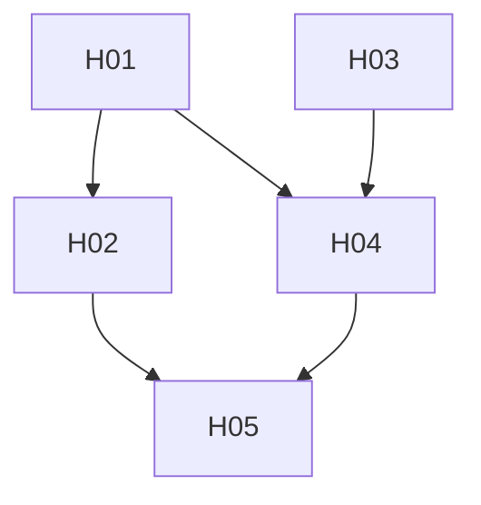

# 聴覚 MVP 計画

`docs/design/voice.md`・`body.md` を前提にした、聴覚（STT）MVP の Goal / Epic / Issue / 依存関係。Epic 名は他の計画と区別するため HE1〜HE3 とする。

## MVP Goal

持ち主が外出先でスマホの Discord から VC に入り、話しかけると、ゆかりさんが声で返す。手は使わず、話しかけ続けられる。

音声を文字にするのは STT の器官で、yunomi の外にある。yunomi が持つのは、器官に音声を渡して文字を受け取る口と、聞いた発話をターンにする部分だけで、器官の中身（モデル、前処理、置き方）は扱わない。器官は発声の器官と同じ自宅側で動く。声を出すのにもともと自宅側が要るので、耳を同じ側に置いても会話が止まる条件は増えない。

```text
スマホ → Discord VC → Gateway（持ち主の声だけ受ける・発話ごとに切る）
  → STT 器官（音声 → 文字）
  → Gateway → Worker（discord.voice.utterance のターン）
  → 聞き取った文字と返事を VC のテキストチャットに書き、返事を発声の器官で合成して VC で流す
```

デモ手順:

1. Discord の VC に、ゆかりさんと持ち主がいる。持ち主はスマホで、イヤホンと音声検出モードを使う。
2. 持ち主が話しかける。数秒後に、ゆかりさんが VC で声で返す。VC のテキストチャットには、聞き取った文字と返事のテキストが並ぶ。
3. 相づちや独り言には、ゆかりさんが返さないことがある。
4. 雑音だけが続いても、ゆかりさんは勝手に返事を始めない。
5. 同じ VC にいる持ち主以外の声は聞かない。

## Epic 一覧

| Epic | ユーザーから見える成果 | 依存 |
| --- | --- | --- |
| HE1 | Gateway が VC で持ち主の声を受け、発話ごとに STT 器官へ渡し、文字を Worker に送る | HE2 の型 |
| HE2 | Worker が聞いた発話をターンにし、声で返す。聞こえるかどうかが身体の状態に入る | なし |
| HE3 | 通しの確認 | HE1, HE2, STT 器官 |

### HE1. Gateway の耳

- 技術範囲: `apps/gateway` で VC に耳を開けて入る（`selfDeaf: false`）。`@discordjs/voice` の receiver で持ち主の音声だけを受け、DAVE の復号と Opus のデコードをし、無音で区切って 16kHz mono の WAV にする。STT 器官の client。聞いた文字を `discord.voice.utterance` として Worker に送る。持ち主の Discord ID を Gateway の設定に足す。
- 非ゴール: ノイズ除去と細かい発話の判定（STT 器官が持つ）、割り込みの判定、複数人の聞き分け。
- Done: fake の STT 器官を使ったテストで、持ち主の音声だけが発話ごとに器官へ渡り、返った文字が Worker に送られる。器官が空を返した発話は Worker に送られない。

### HE2. 聞いた発話のターン

- 技術範囲: `packages/protocol` に `discord.voice.utterance` の Envelope と、それを `InboundMessage` に変える関数。`apps/worker` の受信経路で新しい type を受け、Partner DO のターンに乗せる。発話の宛先は VC のチャンネル ID とし、今の「VC のテキストチャットへの返事は声でも流す」経路で返す。聞き取った文字は、ターンの前に身体が VC のテキストチャットに書く。身体の状態に耳（聞こえる・聞こえない）を足し、`packages/conversation` の「声は聞こえない」の行を、耳の状態に応じて書き分ける。
- 非ゴール: 返事 1 つの中で文ごとに合成して流すこと、割り込み。
- Done: 発話の Envelope から、聞き取った文字がチャットに書かれ、ターンが回り、VC に声の指示が返ることがテストで確かめられる。耳が使えるときと使えないときで、プロンプトの行が変わる。

### HE3. 通しの確認

- 技術範囲: prod での通し（dev の bot は Discord に繋がない）、遅さと誤反応の記録。Gateway の設定（STT 器官の URL とトークン、持ち主の ID）の登録。
- Done: スマホから話しかけて声で返るところまでが通る。話し終わりから声が返るまでの時間と、誤反応の回数を記録する。

## STT 器官との契約

yunomi が器官に求めるのは、次の入力と出力だけとする。

`transcribe` の入力:

| 項目 | 内容 |
| --- | --- |
| `audio` | 16kHz mono の WAV（base64） |
| `language` | `ja` |
| `speaker` | 誰の声を文字にするか（持ち主の Discord ID）。器官は、この人の声と判定した部分だけを文字にする |
| `initial_prompt` | 固有名詞の語彙（ゆかりさん、yunomi など）。省略できる |

`transcribe` の出力:

| 項目 | 内容 |
| --- | --- |
| `text` | `speaker` の声と判定した部分の文字。`speaker` の発話がないと判定したときは空 |
| `duration_ms` | 器官が発話とした長さ |

雑音や無音から作られた文字と、`speaker` 以外の声（同じマイクに入った周りの人の声やテレビ）を捨てるのは器官の責任で、yunomi は空の `text` を「何も聞こえなかった」として扱う。誰の声かを判定するための声の登録は器官が持ち、yunomi は ID で指定するだけとする。精度は高くなくてよく、持ち主の声が少し欠けるのは許す。

自宅側の機械を起こしたままにするのは、今と同じく Gateway が VC にいる間に発声の器官へ送る `keep_awake` に任せる。

## Issue 一覧

| ID | Epic | タイトル | 依存 | 並行 |
| --- | --- | --- | --- | --- |
| H01 | HE2 | `discord.voice.utterance` の Envelope と `InboundMessage` への変換 | - | H03 と並行 |
| H02 | HE2 | Worker: 発話のターンと、耳の状態のプロンプト反映 | H01 | H03, H04 と並行 |
| H03 | HE1 | Gateway: 持ち主の音声を受けて発話ごとに切る | - | H01 と並行 |
| H04 | HE1 | Gateway: STT 器官の client と Worker への送信 | H01, H03 | H02 と並行 |
| H05 | HE3 | 通しの確認 | H02, H04, STT 器官 | - |

## 依存グラフ



### クリティカルパス

H03 → H04 → H05

H03 は DAVE の復号と Opus のデコードという未確認の部分を含むので、最初に着手する。STT 器官が揃うまで、H04 は fake の器官で進める。

### 並行して進められる作業

- H01 / H03 は最初から並行
- H01 の後: H02
- H01 と H03 の後: H04（H02 と並行）

### 非ゴール

- STT 器官の実装
- 割り込み（ゆかりさんが話している間に話しかけたときの判定）。MVP では再生を続け、聞いた発話は順に処理する
- 返事を文ごとに合成して流すこと
- 持ち主以外の声を聞くこと
- チャットに書かない形。書くかどうかは聞き取った文字と返事で揃え、書かないときはゆかりさんも声だけで返す。MVP は書く形で確かめる

### 確かめておくこと

- DAVE: VC の音声はエンドツーエンドで暗号化されている。`@discordjs/voice` 0.19.2 と `@snazzah/davey` で、受信した音声を復号できるか。
- Opus のデコード: Gateway は `opusscript`（WASM）を使っている。常時の受信でデコードが追いつくか。
- スマホの Discord: 画面を消したまま VC に残り、音声検出モードで送り続けられるか。
- 遅さ: 話し終わりから声が返るまでの時間。Gateway が無音で区切るまでの待ち時間が、そのまま遅れに乗る。
- 返事の費用: 発話ごとに LLM のターンが 1 回回る。1 時間の会話で何ターンになるかを数える。

### 決めたこと

- チャットへの書き方: 聞き取った文字と返事の両方を VC のテキストチャットに書く。どちらかだけを書くことはしない。
- 聞く相手: 持ち主の Discord ID の声だけを聞く。持ち主のマイクに周りの人の声が入っても、器官が持ち主の声の部分だけを文字にし、ゆかりさんには持ち主の言葉だけが届く。

### 最初の 2 Issue

1. H03 Gateway: 持ち主の音声を受けて発話ごとに切る
2. H01 `discord.voice.utterance` の Envelope と `InboundMessage` への変換

H03 で未確認の部分を先に潰し、H01 で型を固めると H02 と H04 が並行に進められる。
