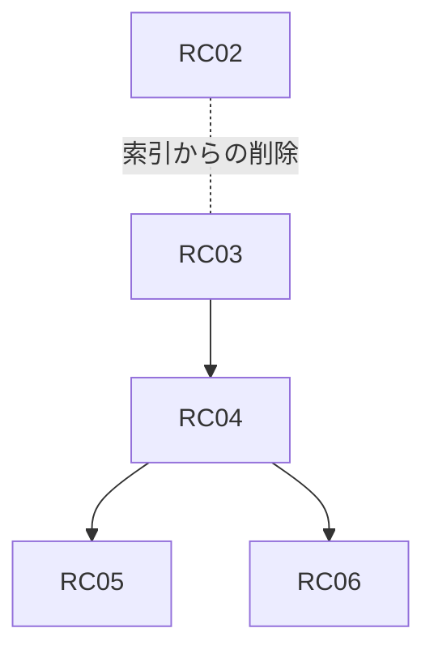

# 記憶の想起の計画

Partner が昔の話を、人と同じように連想で思い出すための Goal / Epic / Issue。Epic 名は他の計画と区別するため RC とする。`design-review.md` の B4 は、Prompt に入れる Fact を importance と recency の上位 N 件に限り、意味検索をしないと定めた。この計画はその方針を改め、意味検索とキーワード検索による連想を足す。

## いまの記憶の見え方

毎ターンの Prompt に入る記憶は、`topFacts` が選ぶ固定の枠だけである。

| 種類 | 選び方 | 上限 |
| --- | --- | --- |
| 持続する事実（`decay_policy` = standard） | importance 順、次に新しい順 | 30 件 |
| 出来事（episodic） | 新しい順 | 30 件 |
| Working のメモ（`work_notes`） | 新しい順 | 10 件 |
| チャンネルの直近の発言（DO の `recent_messages`） | 新しい順 | 30 件 |

選び方は届いた発言を見ない。31 件目より後の記憶は D1 に残っていても Prompt に入らず、「昔のことを思い出して」と頼まれても答えられない。3 日以上前の出来事は「前に聞いた話」に回り、自分からは持ち出さないよう指示されている。記憶を検索する道具はない。

`conversation_messages` は返事をしたターンの会話を無期限に書き溜めているが、読む経路がない。

## Goal

話題に関係する昔の記憶が、返事をするターンに自然に浮かぶ。最近思い出したものや何度も出た話は浮かびやすく、長く触れていない話は「たぶん」「自信はないですけど」と曖昧に思い出す。記憶は消さず、忘れることは浮かびにくさで表す。

保存している会話の中身・保持期間・消し方が文書になっていて、持ち主は `ykm` から会話ログを消せる。

## 方針

### 連想

- 想起は連想だけで行う。記憶を検索する道具は作らない。モデルが道具を呼ぶかどうかに想起を任せず、話題から浮かぶ形にする。
- 連想は Gate が返事をすると決めたターンでだけ走らせる。返事をしないターンでは埋め込みの費用も遅延も発生しない。
- 手がかりは直近数件の発言とする。「去年の春」「先月」のような期間の表現は、検索の絞り込みとして解釈する。
- 意味検索（Workers AI の埋め込み `bge-m3` と Vectorize）とキーワード検索（D1 FTS5）の結果を RRF でまとめ、保持率 R を掛けて並べる。閾値を超えたものだけを最大 5 件差し込む。固定の枠に既にある記憶は除く。
- 連想で浮かんだ記憶には「自分からは持ち出さない」を当てない。関連が強ければ自分から触れてよい。

### 忘却曲線

保持率は R = exp(−t / S) で表す。t は最後に触れてからの日数、S は定着の度合いである。S は importance、想起された回数、持ち主が同じ話を再び出したことで伸びる。想起は間隔反復と同じく、思い出すたびに次の S を伸ばす。

R は並べ方にだけ使い、行を消さない。`observed_at` は書き換えず、想起は `recall_count` と `last_recalled_at` に記録する。

R が低い記憶は、日付を「去年の秋ごろ」くらいに粗くし、細部を落として渡す。返事では「たぶん」「自信はないですけど」のような自信のない言い方になる。

固定の枠も、連想が入った後で R の順に並べ替える。よく話題に出る事実が枠に残り、触れられない事実は連想でしか浮かばなくなる。

### 検索の対象

| 対象 | 索引に入れる単位 |
| --- | --- |
| `facts`（持続する事実と出来事） | 1 行ずつ |
| `work_notes` | 1 行ずつ |
| `conversation_messages` | 前後数件をまとめた塊。持ち主と Partner の発言だけ |

持ち主以外の人の発言は索引に入れない。ほかの人がその場にいた話を Partner が勝手に掘り起こさないためである。

### 会話ログの保持

`conversation_messages` の原文は無期限に残す。持ち主と Partner 以外の発言は 90 日で消す。特定の期間やメッセージのログは、`ykm` のメンテナンス用のコマンドで消せる。消した行は Vectorize と FTS5 の索引からも消す。

## Epic 一覧

| Epic | ユーザーから見える成果 | 依存 |
| --- | --- | --- |
| RC（#316） | 話題に関係する昔の記憶が、忘却曲線に沿った確かさで浮かぶ | なし |

### RC. 連想で思い出す

- 技術範囲: 保存している会話データの棚卸しと文書化、会話ログの保持と削除、Vectorize と FTS5 の索引、返事をするターンの連想、忘却曲線、persona eval。
- 非ゴール: 記憶を検索する道具、会話ログの要約、記憶の行の削除による忘却、持ち主以外の人の発言の想起。
- Done: prod で「前にPC探しに行った話覚えてる？」のように昔の話題を振ると、30 件の枠の外にある記憶を含めて答える。長く触れていない話は曖昧な言い方になる。`docs/privacy.md` が保存先を網羅し、`ykm` から会話ログを消せる。

## Issue 一覧

番号は計画上の ID。右端の列が GitHub Issue の番号。

| ID | タイトル | 依存 | 並行 | GitHub |
| --- | --- | --- | --- | --- |
| RC01 | 保存している会話データの棚卸しと `docs/privacy.md` の書き直し | - | RC02, RC03 と並行 | #310 |
| RC02 | 会話ログの保持期間と `ykm` からの削除 | - | RC01, RC03 と並行 | #311 |
| RC03 | Vectorize と FTS5 の索引、既存データの一括投入 | - | RC01, RC02 と並行 | #312 |
| RC04 | 返事をするターンの連想と期間の解釈 | RC03 | - | #313 |
| RC05 | 忘却曲線と曖昧な思い出し方、固定枠の並べ替え | RC04 | - | #314 |
| RC06 | 想起の persona eval | RC04 | RC05 と並行 | #315 |

RC02 の削除は、RC03 の索引ができた後で索引からも消すようにする。先に入った方に合わせて、後から入る方が繋ぐ。

### RC01. 保存している会話データの棚卸し

- 技術範囲: `docs/privacy.md` を、保存先・内容・保持期間・削除手段の表に書き直す。対象は D1 の各テーブル、DO の `recent_messages` と `processed_events`、R2 のスナップショット、ログ。外部の処理先（Anthropic、Workers AI、Vectorize、ochoko、kukicha）も書く。期限切れの `memory_candidates` を消す処理を日次の cron に足す。`WORK_CATEGORY_IDS` が未設定のとき、仕事カテゴリの発言が Talking に流れることを防ぐ扱いを決めて入れる。
- Done: `docs/privacy.md` がコードと食い違わない。期限切れの `memory_candidates` が cron で消えることがテストで確かめられる。

### RC02. 会話ログの保持と削除

- 技術範囲: 日次の cron で、持ち主と Partner 以外の発言を 90 日で消す。Admin API に会話ログの削除（期間、チャンネル、メッセージ ID）を足し、`ykm` にメンテナンス用のコマンドを足す。削除は件数を返し、Audit に削除したことと件数だけを残す。
- Done: 90 日を過ぎた他人の発言が消え、持ち主と Partner の発言が残ることがテストで確かめられる。`ykm` から期間を指定して消せる。

### RC03. 索引

- 技術範囲: Vectorize の index と binding、Workers AI の binding、`facts`・`work_notes`・`conversation_messages` を引く FTS5 の仮想テーブル。書き込みの経路で索引を更新し、置き換えや削除では索引からも消す。既存のデータを一括で索引に入れるコマンド。index の作成と Cloudflare 側の設定は chabatake と分担する。
- Done: 書き込み・置き換え・削除で索引が追従することがテストで確かめられる。prod の既存データが索引に入っている。

### RC04. 連想

- 技術範囲: 返事をするターンで、直近数件の発言から手がかりを作り、期間の表現を絞り込みに変え、意味検索とキーワード検索を RRF でまとめて最大 5 件を Prompt に差し込む。固定の枠と重なるものは除く。浮かんだ記憶の `recall_count` と `last_recalled_at` を更新する。Prompt では、連想で浮かんだ記憶に「自分からは持ち出さない」を当てない。
- Done: 枠の外の記憶が、関係する発言に対して差し込まれ、関係しない発言では差し込まれないことがテストで確かめられる。返事をしないターンでは埋め込みを呼ばない。

### RC05. 忘却曲線

- 技術範囲: R = exp(−t / S) の計算と、S を伸ばす要素（importance、想起の回数、持ち主が同じ話を再び出したこと）。RC04 の並べ方に R を掛ける。R が低い記憶は日付を粗くし、曖昧な思い出し方になるよう Prompt での見せ方を変える。固定の枠を R の順に並べ替える。
- Done: 同じ記憶でも、最近思い出したものは R が高く、長く触れていないものは低いことがテストで確かめられる。R の低い記憶の日付が粗くなる。

### RC06. 想起の persona eval

- 技術範囲: 昔の話題を振ったときに枠の外の記憶を使うか、古い記憶で自信のない言い方になるか、関係しない場面で昔の話を持ち出しすぎないかを確かめる eval。
- Done: Tier 2 の eval として回り、RC05 の係数の調整に使える。

## 依存グラフ

## 未決事項

要判断: 連想の閾値、RRF の重み、S の係数。RC06 の eval で決める。

要判断: 会話ログを索引に入れる塊の大きさ。前後何件をまとめるか、時間の切れ目で区切るか。RC03 で決める。
