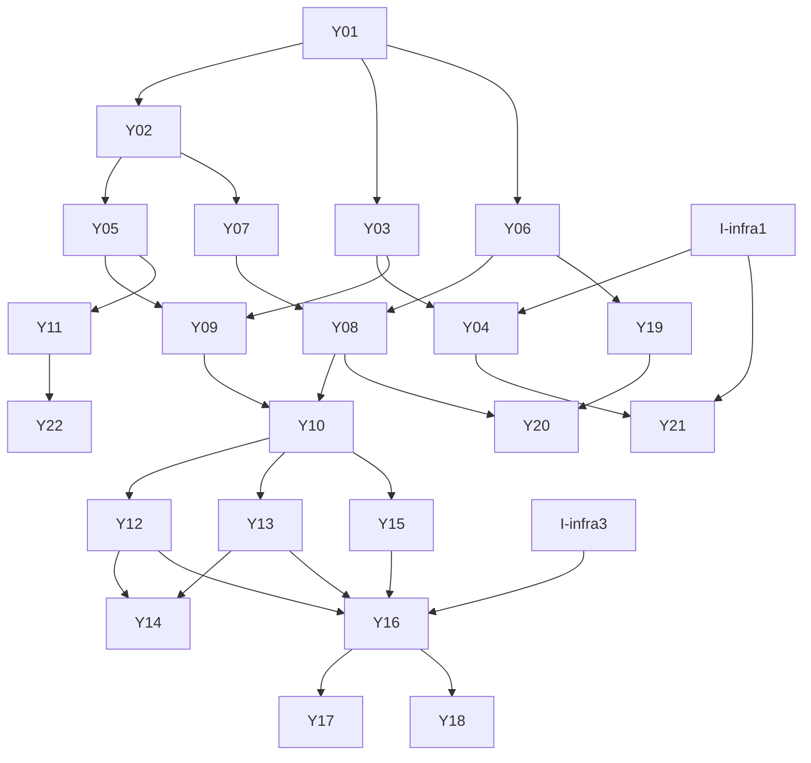

# MVP 計画

`docs/design/` と `docs/plan/design-review.md` の推奨修正を前提にした、MVP の Goal / Epic / Issue / 依存関係。

## MVP Goal

dev の Discord サーバーで Yukarin に話しかけると、Yukarin はチャンネルの直近の流れと最小限の記憶・状態を踏まえ、丁寧語で返事をするか、意図的に黙る。その判断理由・状態の変化・記憶候補は Admin UI と `ykm` で確認でき、再起動後も残る。prod には手動操作でだけデプロイされる。

デモ手順:

1. dev サーバーで「@Yukarin こんにちは、私は自転車が趣味なんです」と送る → 丁寧語で返事が来る。
2. 続けてメンションなしで話を続ける → 継続会話として返事が来る。
3. 相槌だけの発言や他人同士の会話を流す → Yukarin は黙る。
4. `ykm audit tail` で reply / ignore と判断サマリ、`ykm memory list` で「趣味=自転車」の Fact を確認する。
5. Worker を再デプロイした後、「私の趣味、覚えてます？」と聞く → Fact を踏まえて答える。
6. Admin UI で State（mood/energy）と Relationship（familiarity/trust）の変化を確認する。

## Epic 一覧

| Epic | ユーザーから見える成果 | 依存 |
| --- | --- | --- |
| E0 | dev に空の Yunomi が立ち、PR で CI が回る | なし |
| E1 | Yukarin が Discord のメッセージを受け取り、返事をするか黙るかを自分で決める | E0 |
| E2 | Yukarin が会話をまたいで、相手のことと自分の調子を覚えている | E1 |
| E3 | owner が Admin UI と `ykm` で、Yukarin がなぜそうしたかを確認できる | E1（E2 と並行可） |
| E4 | Yukarin らしさが CI と nightly eval で守られる | E1 |
| E5 | dev と prod が分離され、prod は手動でだけ更新される | E0 |

### E0. dev に空の Yunomi が立ち、PR で CI が回る

- 技術範囲: pnpm workspaces + Turborepo、TypeScript 設定、Biome、Vitest、`packages/core`（ID・エラー型・Valibot 境界）、`apps/worker`（`cf` + `cloudflare.config.ts`、Partner DO と D1 の binding、Drizzle、migration）、PR CI、main→dev deploy。
- 非ゴール: prod 環境、Queues、R2、Vectorize、Admin。
- Done: `pnpm install && pnpm turbo typecheck test` が通る。dev の `GET /health` が 200 を返し、DO と D1 への疎通結果を含む。PR で CI が自動実行される。

### E1. Yukarin が Discord のメッセージを受け取り、返事をするか黙るかを自分で決める

- 技術範囲: Discord event の Envelope と Valibot スキーマ、Home Gateway Agent（Node + discord.js + Docker）、Yunomi の受信 endpoint、Partner DO（チャンネル別 recent context、直列化、dedupe）、Yukarin 静的プロファイル、`LLMProvider` + `ClaudeProvider`（structured output、Prompt Caching、Sonnet→Haiku fallback）、PromptBuilder、reply/ignore のハイブリッド判定。
- 非ゴール: 自発発言、DM、添付の中身の解析、チャンネル別ポリシー、Queue、ツール実行。
- Done: dev サーバーでメンションに対して丁寧語で返事が来る。継続会話はメンションなしでも返事が来る。明らかに返事不要な発言には返事しない。fake LLM を使った E2E テストで reply と ignore の両方が再現する。

### E2. Yukarin が会話をまたいで、相手のことと自分の調子を覚えている

- 技術範囲: 最小 Partner State（mood/energy/presence/system_stress/degraded_mode）と Relationship（familiarity/trust、`(partner, entity)` キー）、bounded delta、D1 の履歴、`memory_candidates` と `facts`、決定的な昇格ルール、Prompt への Fact 注入、DO 再起動後の復元。
- 非ゴール: Episode、Vectorize、意味検索、要約、Open Loop の保存、Opinion/Interest の更新。
- Done: 1 ターンでの state/relationship の変化量が上限内に収まることを unit test で保証する。明示的な自己申告が Fact として D1 に残り、DO を作り直した後の会話で参照される。

### E3. owner が Admin UI と `ykm` で、Yukarin がなぜそうしたかを確認できる

- 技術範囲: D1 の audit テーブル（入力、判断、判断サマリ、モデル、fallback、state delta、memory 書き込み、token 数）、30 日で削除する Cron、Admin 読み取り API（Access JWT 検証）、`apps/admin`（Vite + TS + plain DOM、State/Memory/Audit の 3 画面、ポーリング）、`apps/cli` の `ykm status` / `ykm memory list` / `ykm audit tail`。
- 非ゴール: 変更系 UI・コマンド、SSE、コスト画面、Relationship/Open Loop 画面。
- Done: 1 回の会話につき 1 件の audit が残り、chain-of-thought を含まない。Admin UI と `ykm` で同じ内容が見える。Access を経由しないリクエストは 401/403 になる。

### E4. Yukarin らしさが CI と nightly eval で守られる

- 技術範囲: persona 本文（official / fanon / yunomi の 3 層、価値観・境界、呼び方、持ちネタと cooldown）、Tier 1 eval（PR、決定的: 丁寧語ヒューリスティック、持ちネタ cooldown、スキーマ）、Tier 2 eval（nightly、LLM judge、複数サンプルの平均・分散・閾値違反率）。
- 非ゴール: Tier 3（人手レビュー）、JEV などの ML 分類器。
- Done: PR CI で Tier 1 が走る。nightly で Tier 2 が走り、`politeness_score` / `persona_consistency` / `over_agreement_rate` / `reply_rate` を JSON で残す。

### E5. dev と prod が分離され、prod は手動でだけ更新される

- 技術範囲: prod 用の Worker / D1 / DO namespace / Discord bot application / secret、prod deploy workflow（GitHub Environment で保護）、Cloudflare Access（Admin 用 app と Gateway/`ykm` 用 service token）、Home Gateway の Docker 運用。
- 非ゴール: staging、snapshot による prod→dev seed（Goal 2）、バックアップ。
- Done: dev と prod が別の D1・別の Discord bot を使う。main への merge で prod が変わらない。prod deploy は承認付きの手動操作でだけ実行される。

## Issue 一覧

番号は計画上の ID。GitHub Issue は Epic E0〜E5 が #1〜#6、インフラ作業が #7、Y01〜Y22 が #8〜#29（YNN = #(NN+7)）。

| ID | Epic | タイトル | 依存 | 並行 |
| --- | --- | --- | --- | --- |
| Y01 | E0 | monorepo の土台と PR CI | - | - |
| Y02 | E0 | `packages/core`: UUID v7・ドメインエラー・Envelope・EventBus interface | Y01 | Y03 と並行 |
| Y03 | E0 | `apps/worker`: `cf` + `cloudflare.config.ts`、Partner DO、D1 + Drizzle、`/health` | Y01 | Y02 と並行 |
| Y04 | E0 | main → dev 自動デプロイ | Y03, I-infra1 | - |
| Y05 | E1 | Discord 受信イベントの契約（Valibot スキーマ + 内部型変換） | Y02 | Y06, Y07 と並行 |
| Y06 | E1 | Yukarin 静的プロファイルの形式とローダー | Y01 | Y05, Y07 と並行 |
| Y07 | E1 | `LLMProvider` と `ClaudeProvider`（structured output、Prompt Caching、fallback） | Y02 | Y05, Y06 と並行 |
| Y08 | E1 | PromptBuilder と応答スキーマ | Y06, Y07 | - |
| Y09 | E1 | 受信 endpoint と Partner DO の会話処理（recent context、直列化、dedupe） | Y03, Y05 | Y08 と並行 |
| Y10 | E1 | reply / ignore のハイブリッド判定と会話パイプラインの結線 | Y08, Y09 | - |
| Y11 | E1 | Home Discord Gateway Agent | Y05 | Y06〜Y10 と並行 |
| Y12 | E2 | 最小 Partner State と Relationship（bounded delta、D1 履歴） | Y03, Y10 | Y13 と並行 |
| Y13 | E2 | Fact memory candidate の保存と Fact への昇格・Prompt 注入 | Y03, Y10 | Y12 と並行 |
| Y14 | E2 | 会話 E2E シナリオ（reply / ignore / 記憶 / 状態 / fallback / 再起動） | Y12, Y13 | - |
| Y15 | E3 | Audit の記録と保持期間 | Y10 | Y12, Y13 と並行 |
| Y16 | E3 | Admin 読み取り API と Access JWT 検証 | Y12, Y13, Y15 | - |
| Y17 | E3 | Admin Web（State / Memory / Audit） | Y16 | Y18 と並行 |
| Y18 | E3 | `ykm` CLI（status / memory list / audit tail） | Y16 | Y17 と並行 |
| Y19 | E4 | Yukarin persona 本文 | Y06 | Y07 以降と並行 |
| Y20 | E4 | persona eval Tier 1（PR）と Tier 2（nightly） | Y08, Y19 | - |
| Y21 | E5 | prod 環境と手動 prod デプロイ | Y04, I-infra1 | - |
| Y22 | E5 | Home Gateway の Docker 運用 | Y11 | - |

インフラ側（`cf-yunomi` / chabatake 担当）:

| ID | 内容 | 必要になる Issue |
| --- | --- | --- |
| I-infra1 | Cloudflare の API token（dev/prod deploy 用）と CI への注入経路（1Password Service Account） | Y04, Y21 |
| I-infra2 | Worker のカスタムドメイン（例: `yunomi.chanu.co` / `yunomi-dev.chanu.co`）と `workers.dev` 無効化 | Y16, Y11 の本番接続 |
| I-infra3 | chabatake `app_yunomi.tf`: Access application（Admin、owner のみ）と service token（Gateway / ykm、dev/prod 別） | Y16, Y17, Y18, Y11 の本番接続 |
| I-infra4 | Discord bot application（dev / prod）の作成と Message Content Intent の有効化 | Y11 の実機確認 |
| I-infra5 | Anthropic API key の Worker secret 登録（dev / prod） | Y10 の実機確認 |

I-infra4 は Discord Developer Portal での人手操作が必要。I-infra1・3・5 は 1Password の承認が要るため、承認が取れるまでは local（`cf dev` + fake LLM）で進める。

## 依存グラフ

### クリティカルパス

Y01 → Y03 → Y09 → Y10 → Y12 / Y13 → Y16 → Y17 / Y18

Y02 → Y05・Y07 と Y06 → Y08 は Y03〜Y09 と並行で進められ、Y10 で合流する。Gateway（Y11）は Y05 の後ならいつでも着手でき、Y10 が終わるまでに用意できればデモに間に合う。

### 並行して進められる作業

- Y01 の後: Y02 / Y03 / Y06
- Y02 の後: Y05 / Y07
- Y05 の後: Y09（Y03 も必要）と Y11
- Y10 の後: Y12 / Y13 / Y15
- Y16 の後: Y17 / Y18
- Y19 は Y06 の後ならいつでも
- インフラ（I-infra*）はコードと独立に並行

### 判断が必要な点

要判断: Relationship を owner 以外のサーバー参加者にも持たせるか。この計画では全員に持たせ、更新上限を共通にする（design-review B3）。

要判断: Worker のホスト名。この計画では `yunomi.chanu.co`（prod）と `yunomi-dev.chanu.co`（dev）を仮置きし、確定は `cf-yunomi` 側で行う。

要判断: prod デプロイの手動ゲートを chabatake と同じ release PR 方式にするか、`workflow_dispatch` + Environment 承認にするか。この計画では後者（単一ブランチ運用のまま手動実行できる）を採る。

### 最初の 5 Issue

1. Y01 monorepo の土台と PR CI
2. Y03 `apps/worker`: `cf` + `cloudflare.config.ts`、Partner DO、D1 + Drizzle、`/health`
3. Y02 `packages/core`: UUID v7・ドメインエラー・Envelope・EventBus interface
4. Y05 Discord 受信イベントの契約
5. Y07 `LLMProvider` と `ClaudeProvider`

Y01 の後は Y02 / Y03 を並行に進め、Y05 / Y07 で E1 の両端（入力契約と LLM 呼び出し）を先に固める。Y06（プロファイル）は小さいので Y08 の直前に入れる。
