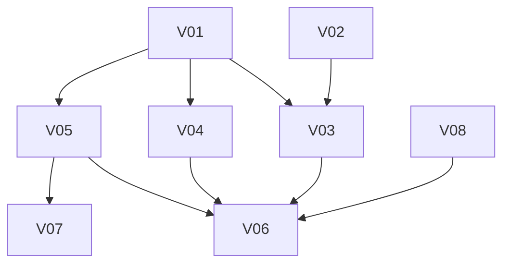

# 声の添付 MVP 計画

`docs/design/principles.md`・`body.md`・`voice.md` を前提にした、声の添付 MVP の Goal / Epic / Issue / 依存関係。Epic 名は `docs/plan/mvp-plan.md` の E0〜E5 と区別するため VE1〜VE4 とする。

## MVP Goal

Yukarin が「声で返そう」と判断したとき、テキストの返事に続けて、そのときの気持ちに合った声の WAV が同じテキストチャンネルに添付される。VC は含めない。

コアは Cloudflare に置き、心・脳・身体の3層に分ける。器官は付け替えのきく部品として、脳か身体の口（port）につなぐ。Discord への送信（テキスト、入力中の表示、添付）は Gateway から身体に移し、Discord REST で行う。Gateway は受信の中継だけを担う。身体は Cloudflare Tunnel + Access 越しに ochoko（発声）と wol（電源）を呼ぶ。

デモ手順:

1. dev サーバーで Yukarin が声で返すと判断する話しかけ方をする → テキストの返事が先に届く。
2. gpu-box が起きていれば、続けてその返事への返信として WAV が添付される。声には LLM が出した感情が反映されている。
3. gpu-box が寝ているときは、身体が wol で起こし、alarm で ready を待ってから WAV を添付する。
4. 2 分以内に ready にならなければ、声は諦められ、テキストだけが残る。諦めたことは身体の状態として脳に返り、次のプロンプトに入る。
5. Gateway は返事の送信も入力中の表示もせず、受信の中継だけをしている。

## Epic 一覧

| Epic | ユーザーから見える成果 | 依存 |
| --- | --- | --- |
| VE1 | 身体が、場所や通信方式に依存しない口と声の性質を持ち、感情の値を A.I.VOICE の値に変えられる | なし |
| VE2 | 脳が「声で返すか」と感情を決め、身体がそれを段取りして声を添付する | VE1, VE3, VE4 |
| VE3 | 返事のテキスト送信が Gateway から身体に移り、Gateway は受信の中継だけになる | VE1 |
| VE4 | ochoko と wol が Tunnel + Access の向こうで呼べ、dev で通しの確認が取れる | なし |

### VE1. 身体の口と声の性質

- 技術範囲: `packages/core` に身体の口（発声、意思疎通の送信と受信、器官の可用性の報告）と、脳から身体へ渡す意図の型。声の性質の型と、IR と声の性質から A.I.VOICE の値を作る純粋関数、器官の可用性から身体の状態を決める純粋関数。`partners/yukarin` にゆかりさんの声の性質（共通部分と A.I.VOICE での実現方法）。
- 非ゴール: 器官の実装、通信、既存コードの3層への組み替え。
- Done: 口と意図の型が場所や通信方式に依存しない。IR → A.I.VOICE の値と、可用性 → 身体の状態の変換が unit test で保証される。

### VE2. 脳と身体の段取り

- 技術範囲: `packages/conversation` で LLM の出力に IR と「声で返すか」を足し、身体の状態をプロンプトに入れ、決めた内容を意図として身体に渡す。`apps/worker` に発声の口の部品（ochoko と wol）と段取り（起こす、alarm で待つ、合成、添付、期限で諦める）。
- 非ゴール: 返事 1 つの中での感情セグメント分割（MVP は返事 1 つにつき声 1 つ）、話している間の keep-awake、Admin での再生。
- Done: fake の器官を使ったテストで、声あり・寝ていた・期限切れの 3 経路が再現する。期限切れでもテキストは届いており、結果が身体の状態として脳に返る。

### VE3. 送信の移行と Gateway

- 技術範囲: `apps/worker` に意思疎通の口の部品として Discord REST（テキスト、入力中の表示、添付）。返事の送信を身体に移し、Gateway への応答を「済み」だけにする。`apps/gateway` から返事の送信と入力中の表示を外す。
- 非ゴール: Gateway 自体の撤去、受信経路の変更。
- Done: テキストの返事が身体から送られ、その message id への返信として添付できる。Gateway は受信を中継するだけで、Discord に何も送らない。

### VE4. インフラと通しの確認

- 技術範囲: chabatake 側（box-cha-d1）での ochoko の Tunnel + Access 公開、ファイアウォールの許可元の見直し、Worker 用 Service Token（wol と ochoko）、`docs/gpu-box.md` の更新。yunomi 側での Worker secret（dev と prod の bot token、ochoko のトークン）の登録と、dev での通しの確認。
- 非ゴール: keep-awake、prod での通しの確認。
- Done: dev の Worker から Tunnel + Access 越しに wol と ochoko が呼べる。dev サーバーで、テキストに続いて声が添付されるところまでの通しが確認できる。

## Issue 一覧

番号は計画上の ID。GitHub Issue は V01〜V08 が #96〜#103（VNN = #(NN+95)）。

| ID | Epic | タイトル | 依存 | 並行 |
| --- | --- | --- | --- | --- |
| V01 | VE1 | 身体の口と意図の型 | - | V02, V08 と並行 |
| V02 | VE1 | 声の性質の型とゆかりさんの値 | - | V01, V08 と並行 |
| V03 | VE1 | IR → A.I.VOICE の値と身体の状態の決定 | V01, V02 | V04, V05 と並行 |
| V04 | VE2 | 脳: 「声で返すか」と IR、身体の状態のプロンプト反映 | V01 | V03, V05 と並行 |
| V05 | VE3 | 身体: Discord REST の口と返事送信の移行 | V01 | V03, V04 と並行 |
| V06 | VE2 | 身体: ochoko・wol の口と声の添付の段取り | V03, V04, V05, V08 | - |
| V07 | VE3 | Gateway を受信の中継だけにする | V05 | V06 と並行 |
| V08 | VE4 | ochoko の Tunnel + Access 公開と secret、dev での通しの確認 | なし（通しの確認は V06） | V01〜V05 と並行 |

V08 は chabatake 側の作業を chabatake の担当者が進める。yunomi の Issue はその進捗を追い、Worker secret の登録と dev での通しの確認を yunomi 側の Done とする。

## 依存グラフ

### クリティカルパス

V01 → V05 → V06

V03 と V04 は V01（V03 は V02 も）の後に V05 と並行で進められ、V06 で合流する。V08 は他と独立に進み、V06 の実機確認の前に揃っていればよい。

### 並行して進められる作業

- V01 / V02 / V08 は最初から並行
- V01 の後: V03（V02 も必要）/ V04 / V05
- V05 の後: V07（V06 と並行）
- V08 は chabatake 側が終わるまで、V06 は fake の器官で進める

### 非ゴール

- VC（音声は UDP のため、VC での再生だけは自宅側の器官に持たせる設計が要る）
- 話している間の keep-awake
- Admin での再生（R2 への保存）
- 1 つの返事の中で感情を変えるセグメント分割
- 聴覚（STT）と視覚
- 既存のコードを心・脳・身体に組み替えること。新しく作る身体と、声のために触る範囲から、この区分けに沿わせる

### 確かめておくこと

- Workers から Discord の REST API を呼ぶと、送信元の IP を多くの利用者と共有するため、IP 単位の制限に当たることがあると言われている。dev で試して確かめる。
- bot token が Gateway と Worker の 2 か所に置かれる（受信と送信で同じ bot を使うため）。

### 判断が必要な点

要判断: ochoko への経路。この計画では Tunnel + Access を使い、Gateway 経由は採らない。

要判断: 期限切れの扱い。この計画では 2 分で声を諦め、テキストだけを残す。

### 最初の 3 Issue

1. V01 身体の口と意図の型
2. V02 声の性質の型とゆかりさんの値
3. V08 ochoko の Tunnel + Access 公開と secret、dev での通しの確認

V01 と V02 で型を固めると V03〜V05 が並行に進められる。V08 は担当が別なので、最初から走らせる。
