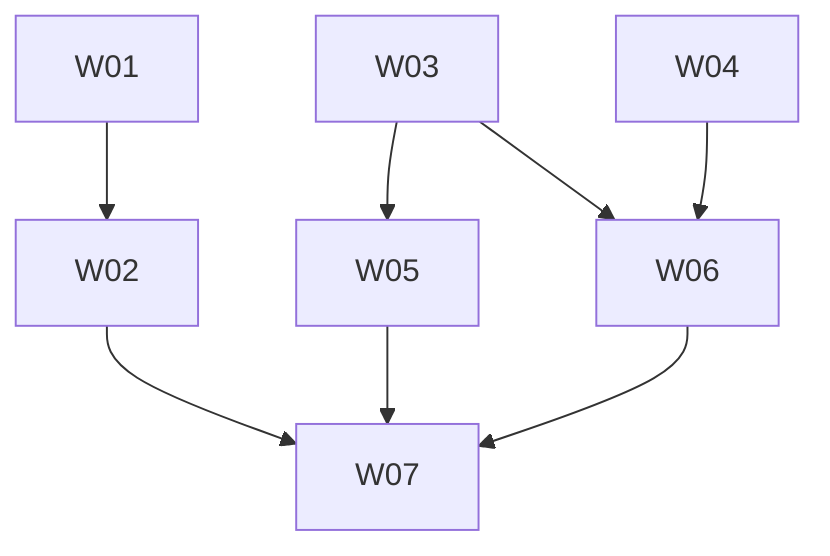

# 会話と仕事をつなぐ計画

Talking（会話の脳）と Working（mizuya の仕事の席）のあいだの Goal / Epic / Issue / 依存関係。今の二つは記憶の口（`docs/working-memory-api.md`）で記憶を共有するだけで、Talking は席がいま何をしているかを知らず、会話から仕事を頼むこともできない。Epic 名は他の計画と区別するため WL1〜WL2 とする。

## Goal

Talking が、仕事の席でいま動いている仕事、オーナーの判断を待っている仕事、終わったばかりの仕事を知っていて、聞かれればそれで答えられる。オーナーが会話の中で仕事を頼むと、了承を経て Working に席が開き、その経過がまた Talking に戻る。

```text
Working の席 → Worker: 出来事の口（started / asking / done / failed）→ D1 working_events
Talking のターン（オーナー）: D1 → prompt の「今の仕事」
Talking の道具 work_request → mizuya の Worker の受け箱（kind work）→ Working が席を開く
```

デモ手順（prod。dev の bot は Discord につながない）:

1. 仕事チャンネルで Working に仕事を頼む。席が動き出したあとにオーナーが会話で「仕事どう？」と聞くと、その仕事が動いていると答える。
2. 席が「決めてほしい」で閉じると、会話で聞いたときに判断待ちとして、聞かれていることを答える。
3. 席が終わると、会話で聞いたときに終わったことと報告の要旨を答える。1 日たつと出なくなる。
4. オーナーが会話で仕事を頼むと、Talking が了承を求め、了承すると仕事フォーラムに投稿が立って席が動く。その席の出来事が 1〜3 と同じように会話に戻る。
5. 出来事が届いたことで、Talking が自分から話しかけることはない。

## Epic 一覧

| Epic | ユーザーから見える成果 | 依存 |
| --- | --- | --- |
| WL1 | Talking が仕事の席の今を知っていて、聞かれれば答える | なし |
| WL2 | 会話の中で頼んだ仕事が、了承を経て Working の席になる | WL1 |

### WL1. 知る

- 技術範囲: Worker に出来事の口 `POST /v1/partners/:partnerId/working/events` を作る（形は `docs/working-events-api.md`）。呼び出し元は `working` だけ。D1 の `working_events` に席（`thread_id`）ごとの最新の出来事を 1 件持ち、`at` が持っているものより古い出来事は捨てる。オーナーが話し相手のターンだけ、prompt に「今の仕事」の区画を出す。出すのは動いている席と判断待ちの席、24 時間以内に終わった席で、新しい順に 5 件まで。日次 cron が、終わってから 7 日を過ぎた行を消す。mizuya の Working は席の 4 つの出来事でこの口を呼び、「決めてほしい」で閉じる席は `asking` で送る。
- 非ゴール: 出来事が届いたときに Talking のターンを起こすこと。席の会話の中身を Talking に渡すこと。
- Done: デモ手順の 1〜3 と 5 が prod で通る。

### WL2. 頼む

- 技術範囲: mizuya の Worker の受け箱に kind `work` を足し、それを書き込む口を作る。yunomi の Worker は Cloudflare Access の service token でその口を呼ぶ。Working は受け箱に届いた `work` から、仕事チャンネルへの依頼（`startFromRequest`）と同じように仕事フォーラムに投稿を立てて席を開く。Talking に道具 `work_request`（件名と依頼の本文）を足す。オーナーのターンだけに出し、policy は `auto` にする。呼んだその場で書き込みの口を 1 回呼び、結果は会話で待たず WL1 の経路で知る。
- インフラ側: yunomi の Worker が mizuya の Worker を呼ぶための Access の service token と、mizuya の Access application の許可。
- 非ゴール: 会話の中で席とやりとりを続けること（判断待ちへの答えは今までどおり仕事の投稿で返す）。オーナー以外からの依頼。
- Done: デモ手順の 4 が prod で通る。

## Issue 一覧

番号は計画上の ID。GitHub Issue は W01〜W07 が #357〜#363（WNN = #(NN+356)）。

| ID | Epic | タイトル | 依存 | 並行 |
| --- | --- | --- | --- | --- |
| W01 | WL1 | Worker: 出来事の口と「今の仕事」 | - | W03, W04 と並行 |
| W02 | WL1 | mizuya: 席の出来事を出来事の口に送る | W01 | W03, W04 と並行 |
| W03 | WL2 | mizuya Worker: 受け箱の kind `work` と書き込みの口 | - | W01, W04 と並行 |
| W04 | WL2 | Access: yunomi の Worker から mizuya の Worker を呼ぶ service token | - | W01, W03 と並行 |
| W05 | WL2 | mizuya Working: `work` の依頼から席を開く | W03 | W06 と並行 |
| W06 | WL2 | Talking の道具 `work_request` | W03, W04 | W05 と並行 |
| W07 | WL1, WL2 | prod でデモ手順を確かめる | W02, W05, W06 | - |

W02・W03・W05 は mizuya の変更で、mizuya の repo で進める。W04 はインフラ側の担当者が進める。

## 依存グラフ



### クリティカルパス

W03 → W06 → W07

W01 と W03 と W04 は最初から並行に進められる。W02 は W01 が prod に出てから mizuya に出す。

### 並行して進められる作業

- W01 / W03 / W04 は最初から並行
- W01 の後: W02
- W03 の後: W05 / W06（W06 は W04 も待つ）

### 非ゴール

- 出来事ごとに Talking のターンを起こして、自分から仕事の様子を話しかけること。費用がかさみ、会話にも割り込みすぎる。
- 席の会話の全文や途中経過の細かい出来事を Talking に渡すこと。
- Talking が Working の席の状態を LAN 越しに読みに行くこと。Worker からは LAN に届かない。
- オーナー以外の人からの仕事の依頼。

### 確かめておくこと

- 席が `done` も `failed` も送らずに止まると、その行は「今の仕事」に動いている仕事として残り続け、日次 cron でも消えない。W07 で、そうした行が溜まっていないかを確かめ、溜まるなら Working が止まった席を `failed` で送るか、Worker が古い `started` を出さないかを決める。
- 出来事の口が落ちているあいだに起きた出来事は、Working が送り直さなければ失われる。最新の 1 件だけを持つので、次の出来事が届けば追いつく。
- `work_request` の了承から席が開くまでのあいだ、Talking は頼んだことを覚えていない。最初の `started` が届くまでの間に聞かれたときの答え方。
- 「今の仕事」の 5 件と 24 時間で足りるか。席が多い日に、判断待ちの席が新しい席に押し出されないか。

### 最初の 3 Issue

1. W01 Worker: 出来事の口と「今の仕事」
2. W03 mizuya Worker: 受け箱の kind `work` と書き込みの口
3. W02 mizuya: 席の出来事を出来事の口に送る

W01 で出来事の形を決め、W02 で mizuya から実際に届くことを早めに確かめる。W03 は W01 と並行に進める。
